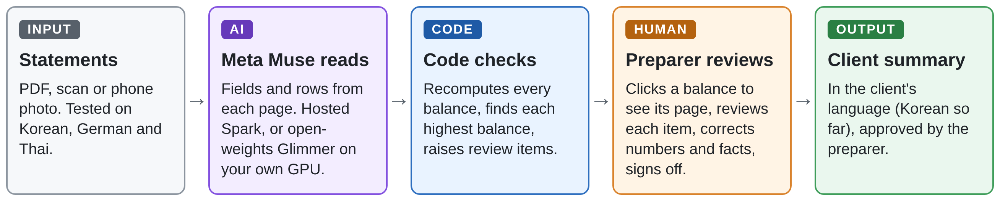
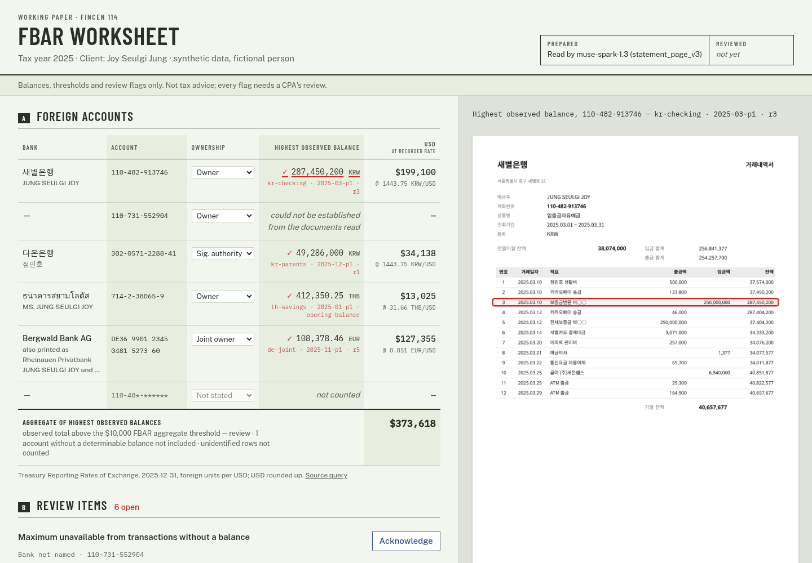

# cross-border-fbar

As a licensed attorney who works with U.S. tax preparers, I had a practical question for this hackathon: could a tool take on the tedious statement review without taking away control over the numbers? This tool was my answer. Built for preparers serving U.S. expats and immigrants with foreign bank accounts, it helps a Certified Public Accountant (CPA) or enrolled agent (EA) automate the reading of bank statements and identify each account's highest balance of the year. The preparer reviews and signs off on those numbers. Each identified highest balance links to its source page in the bank statement for **one-click verification**.

**Try it without installing anything:** [live demo](https://sadhakadev-fbar-worksheet-demo.hf.space), with fictional data and recorded readings. The first visit after a quiet period may take a moment to load.

## The problem it solves

U.S. citizens and U.S. tax residents generally must file an annual Report of Foreign Bank and Financial Accounts (FBAR) with the U.S. Treasury if they have a financial interest in or signature authority over foreign financial accounts whose combined value exceeds $10,000 at any time during the calendar year. Even a non-willful failure to comply with foreign account reporting requirements can carry substantial civil penalties. Willful violations can also lead to criminal prosecution.

For a preparer, the hard part is that the FBAR requires reporting each account's **highest balance during the year**, not simply its year-end balance. Finding that balance can require reviewing individual transactions. A brief spike between month ends can be missed by looking only at month-end balances, even on a clean English statement. Foreign languages, unfamiliar date formats and phone photos make the review harder.

## Meet Joy Seulgi Jung (정슬기)

Joy is a fictional U.S. citizen working in Seoul making about $4,700 a month. Last year she moved to a new apartment. Korea's *jeonse* (전세) rental system requires a large refundable deposit instead of monthly rent. Her old landlord sent back her $173,160 deposit. Two days later, she paid it to her new landlord, so it only passed through her checking account. Another $99,882 from a family inheritance passed through a joint account in Germany for four days. She also has signature authority over her retired parents' foreign bank account. Adding each account's highest month-end balance gives **$121,350**. Adding each account's highest balance at any point during the year gives **$373,618**, capturing spikes that month-end balances miss.

## How it works



The model reads the statements. Deterministic code performs the calculations, so the numbers never depend on the model's arithmetic or explanations. The preparer retains control over every decision and approves the client summary before release.



## Try it in about 3 minutes

No API key needed. All the data is fictional.

**1. Get the code**

```bash
git clone https://github.com/fayerman-source/cross-border-fbar.git
cd cross-border-fbar
```

**2. Install** (requires [uv](https://docs.astral.sh/uv/getting-started/installation/))

```bash
uv sync
```

**3. Generate the fictional statements** (about a minute the first time)

```bash
uv run python -m cross_border_fbar.synth --out out/synth --png
```

**4. Start the worksheet**

```bash
uv run python -m cross_border_fbar.app --set out/synth --readings results/muse-spark-1.3_synth.json
```

**5. Open http://127.0.0.1:8765.** You should see six rows and a total of **$373,618**.

**6. Click 287,450,200 KRW** on the Korean checking row to see the March peak on its source page.

The worksheet opens readings recorded from the live model, so it runs offline. To read a new document live, see [Evaluate one synthetic capture](#evaluate-one-synthetic-capture).

## What's been tested

| Test | Result |
|---|---|
| Hosted Muse Spark, 49 clean pages | 294/294 header fields; 280/280 rows |
| Open-weights Muse Glimmer on a laptop GPU, same pages | 280/280 row values; 244/294 header fields under strict scoring (48 were the right text labeled absent, 2 were a page-level account number on the compiled list, which has none); about 6 minutes a page; nothing sent to a hosted service |
| Reconciliation | Highest observed balance and USD value right on 6/6 accounts (4 numeric results, 2 correctly undetermined). Spark: 9 of 9 expected flags (6 review items, 3 notes), none extra. Glimmer: 9 of 9, plus 1 extra review item |
| Printed pages, re-captured as flatbed scans and as WhatsApp photos | 19/19 rows with every date, amount and balance right; 18/18 header fields after an [answer-key correction](EVAL.md#answer-key-change-nov-1-2026) made after the test (17/18 before), same recorded readings |

- All data is synthetic, on bank layouts we generated. The scans and photos test how a page was captured, not unfamiliar banks.
- Scans and photos show the source page without a line highlight, because locations on them aren't verified.

Full numbers are in [EVAL.md](EVAL.md).

## What the tool does not do

The tool reports balances, thresholds and review items. It gives no legal or tax advice and doesn't say whether anyone must file; the preparer decides. A below-threshold result stays undetermined when omitted values or relevant review items could change it. The Form 8938 panel is indicative and not independently validated.

## Built during the event

This repository was created on October 27, 2026, after the hackathon kickoff. The synthetic statement generator, model-reading and evaluation pipeline, deterministic reconciliation, review worksheet, audit/sign-off, Korean-summary workflow, indicative Form 8938 panel, and single-page photo-evaluation runner were built during the event. The project uses new work in this repository; see commit history for dates.

## Synthetic test data

Run the demo from a clone. The recorded readings and results live in the repository, and the demo set is generated there. An installed package includes only the data and fonts needed to generate synthetic statements and load the bundled rates.

```bash
uv run python -m cross_border_fbar.synth --out out/synth --png
```

This generates a year of monthly statements for one fictional household (Korean, German and Thai banks, all invented) and `truth.json`, the answer key the accuracy test scores against. Each account carries a case the tool must handle:

| Synthetic account | Review case |
|---|---|
| Korean checking | A deposit passes through in March and creates a peak between month ends |
| Parents' Korean account | Signature authority only; the August statement is withheld |
| German joint account | The bank merges mid-year with the same IBAN and a new layout |
| Thai savings | Buddhist-era dates and a debit-first same-day pair |

The answer key follows the FinCEN instructions' statement-based method: the maximum is the largest balance appearing on any statement, converted at the Treasury Dec 31 rate and rounded up. Every field and line also carries its position on the page (0-1000 grid), so extracted locations can be scored.

## The review worksheet

```bash
uv run python -m cross_border_fbar.app --set out/synth --readings results/muse-spark-1.3_synth.json
# open http://127.0.0.1:8765
```

A local app for the preparer. The recorded-reading worksheet runs offline, binds to localhost, and needs no build step. Only translating a phrase missing from the catalog calls the API.

- **Schedule A** lists each account's highest observed balance in the supplied material, subject to coverage and review. Click a highest balance to see its source page. For prepared readings, code snaps the model's box to the printed line and proposes a highlight. On the clean set, 278/280 row centers landed in the right row with Spark's readings and 244/280 with Glimmer's. Opening and closing balances are placed the same way, with none on the wrong line for either model; when the page doesn't settle the line, the page opens without a highlight. The snapping was tuned on those same pages. The preparer must verify each highlight against the page; new captures have no highlight while their locations are unverified.
- **Schedule B** lists the review items. Each must be acknowledged with a note; ownership (owner, joint, signature authority) can be corrected, and the worksheet recomputes.
- **Sign-off** is allowed only when every review item is acknowledged. It records a reviewed snapshot and fingerprint; acknowledged limitations may remain. The signed view and export list review items still present and open threshold determinations. Any change to the worksheet invalidates the sign-off.
- **Client summary in Korean** is assembled from signed numbers and fixed catalog phrases (last four digits, no statement contents, none of the preparer's notes). A phrase missing from the catalog is translated by `muse-spark-1.3`. Unreviewed phrases require explicit confirmation, and the preparer approves the draft before release. A native speaker has reviewed the catalog phrases; changed English or new phrases require review again. The preparer sees the English beside the Korean before approving, and chooses what the client receives: Korean, English or both.

Corrections cover amounts, balances, ownership, financial interest, currency and exchange rate. A corrected number keeps the original reading on record, and the worksheet recalculates. Every action goes to an audit trail (`out/review/audit.jsonl`). The app reads the model's recorded page readings and the intake facts, never the answer key.

## Evaluate one synthetic capture

The photo runner accepts synthetic PNG, JPEG, WebP, TIFF and HEIC/HEIF images, other images supported by Pillow, or one selected PDF page. The required confirmation applies to every input: never use a real person's statement. Live calls use Standard-mode `muse-spark-1.3`, the shared local ledger and a $50 maximum spend cap; `FBAR_SPEND_CAP_USD` can set a lower cap. Successful calls with valid usage are recorded separately for each run. The cap is a local ledger limit, not a provider billing guarantee. If a live request fails, is interrupted, or returns invalid token counts, its estimated reservation stays in the ledger. The ledger does not assume there was no charge, and the page is not appended.

```bash
uv run python -m cross_border_fbar.eval.photo path/to/synthetic-photo.jpg \
  --confirm-synthetic --set out/photo-review \
  --manifest path/to/manifest.json --case kr-checking_2025-03
uv run python -m cross_border_fbar.app --set out/photo-review \
  --readings out/photo-review/readings.json --review-dir out/photo-review/review
```

`--manifest` and `--case` are optional together. When supplied, the runner reports field and row value counts against the synthetic case. The manifest's answer key must be inside the manifest directory (including after resolving symlinks). Without a manifest the page is added but not scored. `--page` selects a 1-based page from a PDF; `--truth-page` selects the original page in the manifest when it differs. Intake defaults to unknown; `--intake` supplies an optional synthetic intake JSON when starting the set. Choose the command's paths yourself; do not expose the command as a tool accepting untrusted model-generated paths.

Photo and scan page geometry differs from the original. With no verified page corners, box accuracy is **unscored**. To evaluate localization, supply `--corners 'x,y;x,y;x,y;x,y'` in upper-left, upper-right, lower-right, lower-left order in the EXIF-oriented input image's pixel coordinates. The runner rectifies the page to the answer-key dimensions before extraction and scoring; manually verify the alignment before relying on the geometry results. The exact raster sent to the model is saved for the worksheet. New photo locations are marked unverified, shown as a page without a highlight, and generate a preparer review item until independently checked. Recorded replay remains the CI default.

## License and model attribution

The project's original code is available under [Apache-2.0](LICENSE). Bundled fonts retain their separate SIL Open Font License terms; dependencies have their own licenses, including LGPL-3.0 for fpdf2. See [third-party notices](docs/third-party.md). Meta's [Muse Glimmer 30B GGUF model](https://huggingface.co/meta-models/Muse-Glimmer-30B-GGUF) is published by Meta under Apache-2.0; model weights are not included in this repository. Muse Spark is accessed through the Meta Model API under its applicable terms.
